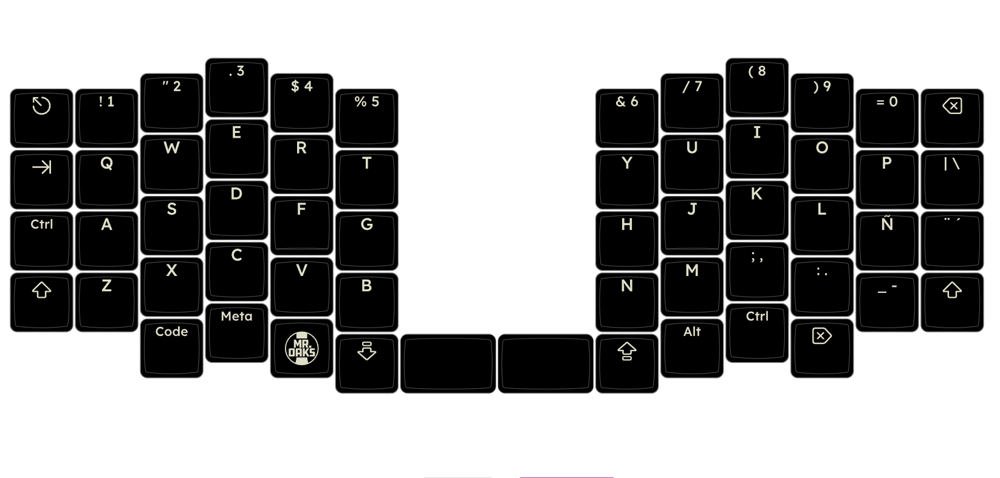

# Sofle Choc - Custom QMK Firmware & Hardware (Mr. Oaks Edition)

Custom QMK firmware, VIA dynamic configuration, and hardware manufacturing files for the **Sofle Choc** split ergonomic mechanical keyboard, designed and maintained by **Mr. Oaks**.


## Features

- **Split Ergonomic Keyboard**: 58 keys (6×4+5 layout with thumb clusters).
- **Switches**: Low-profile Kailh Choc switches with hotswap sockets.
- **Controllers**: ProMicro USB-C (ATmega32u4, 5V / 16MHz) communicating via TRRS serial link.
- **Rotary Encoders**: Dual EC11 rotary encoders with aluminum knobs for volume, media control, and scrolling.
- **OLED Displays**: SSD1306 128x32 OLED screens featuring **Ikki the dog** keyboard pet (WPM-reactive animations: sit, walk, run, bark on Caps Lock, sneak), Mr. Oaks custom logos, and telemetry (layer state, WPM, locks).
- **Per-Key RGB**: RGB Matrix powered by SK6812 Mini-E LEDs with layer-specific indicator colors and reactive animations.
- **VIA Dynamic Keymap**: Full real-time key remapping, macros, and RGB matrix controls via [usevia.app](https://usevia.app) without needing to reflash.
- **Spanish ISO Layout**: Native Spanish punctuation, letters (Ñ, Ç), and symbols mapped directly out-of-the-box.
- **Automated Cloud CI**: GitHub Actions workflow that automatically compiles `.hex` firmware binaries on every push.

> 📖 **Guía de Montaje:** Para el montaje físico, soldadura de componentes paso a paso e instrucciones de ensamblaje, consulta la [Guía de Construcción Sofle Choc](docs/build_guide_choc.md).

---

## Repository Structure

```text
sofle-choc-mroaks/
├── .github/workflows/
│   └── build.yml               # Automated cloud compilation with QMK CLI
├── sofle_choc_via.json         # VIA keyboard definition file (Load in usevia.app -> Design)
├── sofle_choc_mroaks_layout.json # Official layout backup (Load in usevia.app -> Save + Load)
├── keyboards/sofle_choc_mroaks/ # Keyboard hardware definitions, matrix, pins & drivers
│   ├── config.h
│   ├── rules.mk
│   ├── sofle_choc_mroaks.h
│   ├── sofle_choc_mroaks.c
│   ├── lib/                    # OLED fonts & glyphs (font.c, glcdfont.c)
│   └── keymaps/
│       ├── via/                # Official VIA keymap (via_left / via_right split targets)
│       ├── mroaks/             # Static QMK keymap (standalone alternative without VIA)
│       └── default/            # Upstream QMK reference layout
├── hardware/
│   ├── pcb/                    # KiCad PCB schematics, layouts, and footprint libraries
│   ├── gerbers/                # Production-ready Gerber archives (PCB & top plate)
│   ├── cnc/                    # DXF drawings and G-code for milling custom wood cases
│   └── 3d_print/               # STL 3D models (cases, foam templates, CAD models)
└── docs/
    ├── build_guide_choc.md     # Guía detallada paso a paso de ensamblaje y soldadura
    ├── correcciones_keymap.md  # Registro histórico de contrastes de keymap
    ├── keycapsConfiguration.png# Diagrama visual de referencia de teclas y distribución física
    ├── logos/                  # Mr. Oaks logos (high-res and 32px OLED bitmaps)
    └── referencias/            # Material de consulta externa y tutoriales (oled_tutorial)
```

---

## Keycaps Configuration & Layout

Configuración y distribución física de teclas del teclado:



> Para consultar el contraste detallado entre la disposición física y las asignaciones del firmware, revisa el [Registro de Correcciones en Keymap](docs/correcciones_keymap.md).

---

## Keymaps Included

### 1. `via` (Flagship - VIA Dynamic Configuration)
Es el keymap oficial de producción con soporte completo para la interfaz web [VIA (usevia.app)](https://usevia.app):
- **Mitad Izquierda (`via_left`)**: Compila `sofle_choc_via_left.hex` como Master USB. Maneja la conexión WebHID con el navegador, estado de capas en pantalla OLED, WPM, indicadores RGB tecla a tecla y layout en español.
- **Mitad Derecha (`via_right`)**: Compila `sofle_choc_via_right.hex` como Slave. Ejecuta la animación de la mascota **Ikki the Dog** reactiva a la velocidad de escritura (WPM), sincronización de LEDs y encoder derecho.
- **Unificado (`via`)**: Compila `sofle_choc_via.hex` con autodetección dinámica de mitad.

### 2. `mroaks` (Static QMK Firmware)
Versión clásica alternativa para usuarios que prefieren tener el layout estático fijado en el código C sin necesidad de VIA:
- **`mroaks_left`**: `sofle_choc_mroaks_left.hex`
- **`mroaks_right`**: `sofle_choc_mroaks_right.hex`

### 3. `default`
- Layout de referencia estándar de QMK para Sofle Choc.

---

## Hardware & Cases

### PCB Design & Gerbers (`hardware/pcb/`, `hardware/gerbers/`)
- `hardware/pcb/SofleKeyboard.kicad_pcb` & `SofleKeyboard.sch`: Complete KiCad project for Sofle Choc v2.1 with Kailh Choc hotswap sockets, TRRS jack, and SK6812 RGB.
- `hardware/pcb/top_plate/`: KiCad project for manufacturing the FR4 switch top plate.
- `hardware/gerbers/gerber-choc-pcb-v2.1.zip`: Production-ready Gerber archive for JLCPCB/PCBWay (main PCB).
- `hardware/gerbers/gerber-choc-top-v2.1.1.zip`: Production-ready Gerber archive for JLCPCB/PCBWay (top plate).

### CNC Wood Cases (`hardware/cnc/`)
Contiene archivos vectoriales (`.dxf`) y trayectorias de corte listas para fresar cajas de madera maciza en CNC:
- `Madera2.dxf` / `Madera2.gcode`: Cuerpo principal superior e inferior.
- `IzqDelantera.gcode`, `IzqTRasera.gcode`, `DerDelantera.gcode`, `DerTRasera.gcode`: Mecanizados específicos para cada mitad.
- Rutinas de planeado de superficies (`cepillado1`, `cepillado2`).

### 3D Printing (`hardware/3d_print/`)
- `Sofle Case.stl`: Caja imprimible en 3D para montaje estándar.
- `Sofle+Choc+Case+Battery+without+3.5mm.stl`: Versión con espacio para batería (montajes inalámbricos).
- `Foam Template.stl`: Plantilla para corte de espuma amortiguadora de sonido.
- Modelos CAD de referencia de switches, keycaps, encoders, OLEDs y Pro Micro.

---

## Building the Firmware

### Option A: Cloud Build (GitHub Actions - Recommended)
Cada `push` a las ramas `main` o `release-via` compila automáticamente el firmware en la nube:
1. Dirígete a la pestaña **Actions** en este repositorio.
2. Selecciona la ejecución más reciente.
3. Descarga el paquete **`sofle-choc-firmware`** con todos los binarios `.hex` listos para usar.

### Option B: Local Compilation with QMK CLI / MSYS
Para compilar localmente con el CLI de QMK:

```bash
# Compilar firmware VIA (Recomendado)
qmk compile -kb sofle_choc_mroaks -km via_left
qmk compile -kb sofle_choc_mroaks -km via_right

# Compilar firmware estático alternativo
qmk compile -kb sofle_choc_mroaks -km mroaks_left
qmk compile -kb sofle_choc_mroaks -km mroaks_right
```

---

## Flashing Instructions

> ⚠️ **Regla de oro:** Desconecta siempre el cable USB antes de conectar o desconectar el cable TRRS entre ambas mitades.

1. **Mitad Izquierda (Master)**:
   - Conecta la mitad izquierda del teclado al PC mediante USB.
   - Pon el controlador en modo bootloader (doble pulsación al botón de **Reset** o atajo `Lower + Raise + Reset`).
   - Flashea el archivo **`sofle_choc_via_left.hex`** con **QMK Toolbox** (Microcontrolador: `atmega32u4`).
   - Desconecta la mitad izquierda.

2. **Mitad Derecha (Slave)**:
   - Conecta la mitad derecha del teclado al PC mediante USB.
   - Pulsa el botón de **Reset** dos veces seguidas para entrar en modo bootloader.
   - Flashea el archivo **`sofle_choc_via_right.hex`** con **QMK Toolbox**.
   - Desconecta la mitad derecha.

3. **Puesta en marcha y VIA**:
   - Conecta el cable TRRS entre ambas mitades.
   - Conecta el cable USB a la mitad izquierda (maestra).
   - Abre [usevia.app](https://usevia.app) en Chrome/Edge, pulsa **Authorize device** para conectar, y en la pestaña **Save + Load** carga `sofle_choc_mroaks_layout.json` para tener toda la distribución configurada de inmediato.

---

## License

GPL v2 or later (consistent with QMK Firmware licensing).
