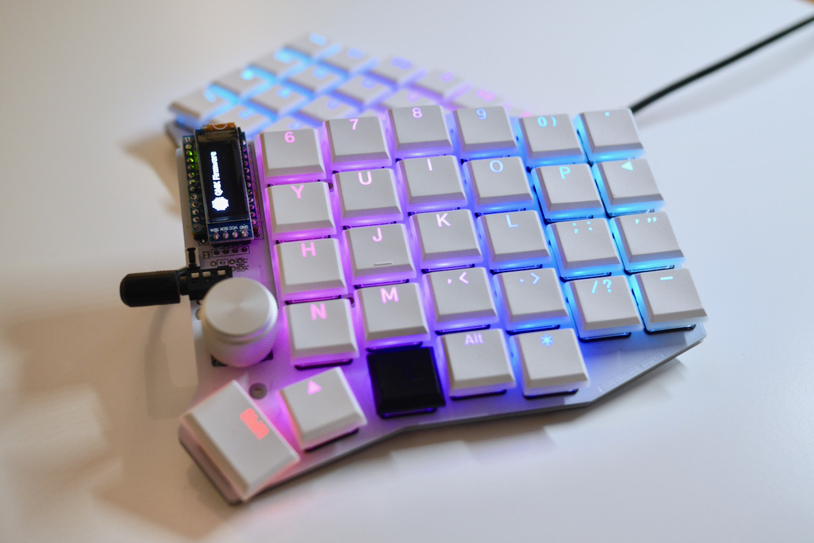
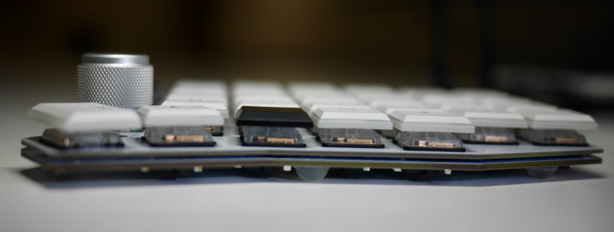
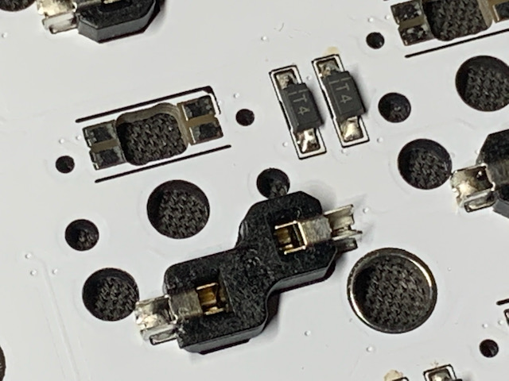
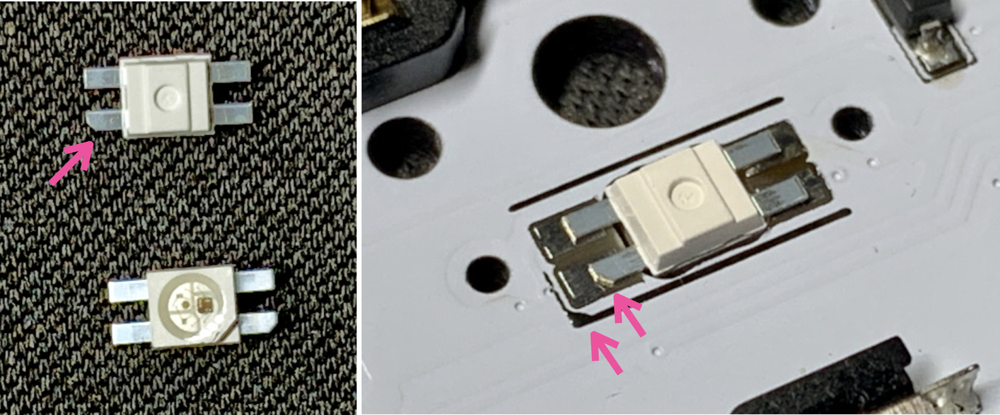
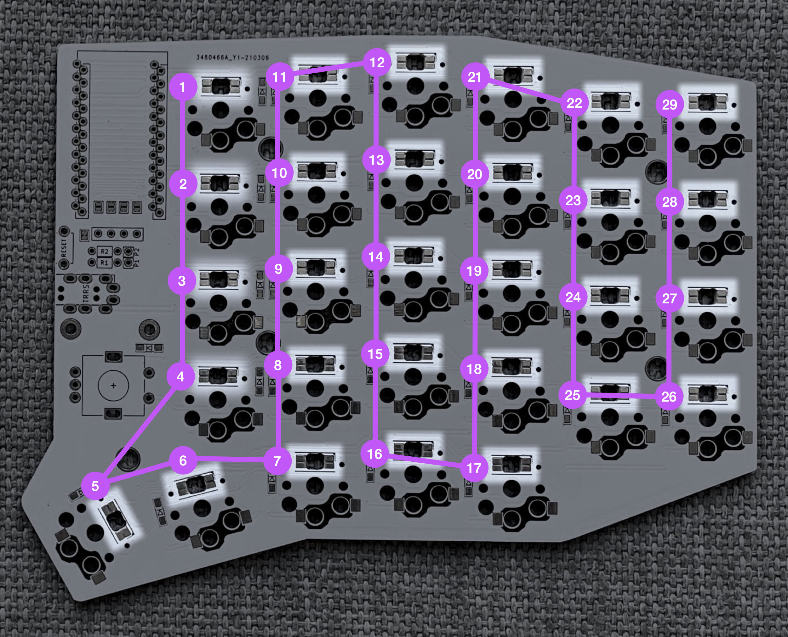
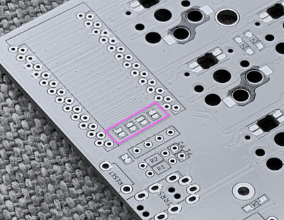
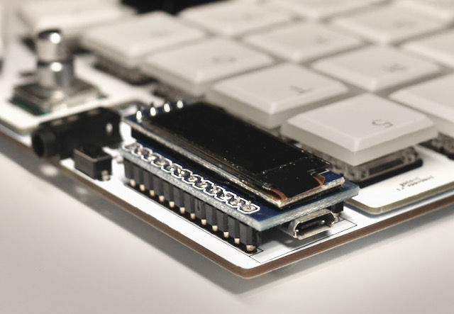

# Guía de Construcción y Ensamblaje: Sofle Choc (Mr. Oaks)

Guía completa paso a paso para el ensamblaje, soldadura y puesta en marcha del teclado dividido ergonómico **Sofle Choc** (versión bajo perfil con switches Kailh Choc, zócalos hotswap, pantallas OLED y retroiluminación RGB).

---

## 1. Características Técnicas

* **Formato**: Teclado dividido de 58 teclas (matriz 6x4 + 5 teclas de pulgar por mano).
* **Switches**: Switches de bajo perfil **Kailh Choc v1 (PG1350)** con zócalos intercambiables (*hotswap*).
* **Microcontroladores**: 2× Pro Micro USB-C / Micro-USB (ATmega32u4, 5V / 16MHz).
* **Pantallas**: 2× OLED SSD1306 128×32 de 0.91" conectadas por I2C.
* **Encoders**: 2× Encoders rotatorios EC11 con pulsador central.
* **Iluminación**: 58× LEDs direccionables SK6812 MINI-E por tecla.
* **Interconexión**: Cable TRRS de 4 polos (3.5 mm).
* **Perfil ultraplano**: ~15 mm de altura total desde la mesa hasta la parte superior de las teclas.

---

## 2. Lista de Materiales (BOM)

### Componentes Electrónicos Obligatorios
* **2× Placas PCB reversibles**: Fabricadas a partir de [`hardware/gerbers/gerber-choc-pcb-v2.1.zip`](../hardware/gerbers/gerber-choc-pcb-v2.1.zip) (o archivos KiCad en [`hardware/pcb/`](../hardware/pcb/)).
* **2× Placas superiores (Top Plate)**: Fabricadas en FR4/PCB desde [`hardware/gerbers/gerber-choc-top-v2.1.1.zip`](../hardware/gerbers/gerber-choc-top-v2.1.1.zip) o carcasas mecanizadas/impresas.
* **2× Microcontroladores Pro Micro**: ATmega32u4 (5V, 16MHz).
* **4× Tiras de 12 pines hembra/macho**: Para montar o socavar los Pro Micros.
* **58× Switches Kailh Choc v1 (PG1350)**: *Importante:* No son compatibles los Choc v2 ni los Cherry MX.
* **58× Zócalos Hotswap Kailh Choc (PG1350)**.
* **58× Diodos 1N4148W** en encapsulado superficial SOD-123.
* **2× Conectores TRRS hembra jack 3.5mm** (modelo PJ-320A).
* **2× Pulsadores táctiles de reset** (3×6×4.3 mm para orificio pasante o SMD).
* **1× Cable TRRS de 4 polos**.
* **1× Cable USB** para conectar el teclado al ordenador.
* **58× Keycaps para perfil Choc**: Tamaño estándar 1u (opcionalmente 1.5u para los pulgares).

### Componentes Opcionales pero Recomendados
* **2× Pantallas OLED SSD1306** de 0.91" (128x32 píxeles, interfaz I2C de 4 pines).
* **2× Tiras de 4 pines hembra** para socavar las pantallas OLED.
* **2× Encoders rotatorios EC11 (EC11E)**: Eje plano o estriado corto con sus respectivos pomos de aluminio.
* **58× LEDs SK6812 MINI-E**: Formato con patillas laterales soldables (3.2×2.8 mm cuerpo).
* **Carcasa exterior**:
  * Carcasa de madera maciza mediante mecanizado CNC: Archivos `.dxf` y `.gcode` en [`hardware/cnc/`](../hardware/cnc/).
  * Carcasa impresa en 3D: Archivos `.stl` en [`hardware/3d_print/`](../hardware/3d_print/).
* **8 a 10 topes de silicona / patas de goma** para la base.

---

## 3. Herramientas Necesarias

* Soldador con control de temperatura (preferiblemente punta fina o biselada, 300°C–340°C).
* Estaño de buena calidad (con núcleo de flux).
* Flux (en lápiz o gel no-clean).
* Pinzas de precisión antiestáticas (curvas o rectas).
* Malla desoldadora o bomba de succión para corregir puentes.
* Alcohol isopropílico y cepillo suave para limpiar residuos de flux.
* Cinta aislante o cinta Kapton.
* Multímetro para pruebas de continuidad.

---

## 4. Proceso de Ensamblaje Paso a Paso

> [!IMPORTANT]
> **Simetría de las placas (Izquierda vs Derecha):**
> Las placas PCB del Sofle Choc son **reversibles**. Una placa servirá para la mano izquierda y la otra para la mano derecha.
> Antes de empezar a soldar nada, coloca ambas placas sobre la mesa mirándose como un teclado para tener claro qué cara será la **superior (FRONT)** y qué cara será la **inferior (BACK)** en cada mitad. **Nunca sueldes dos mitades del mismo lado por error.**

---

### Paso 1: Soldadura en la Cara Trasera (BACK)

Todos los componentes superficiales bajos se sueldan en la **cara inferior (trasera)** de la PCB:

1. **Diodos 1N4148W (58 unidades):**
   * Se colocan en la cara trasera.
   * **Polaridad:** Cada diodo tiene una línea blanca serigrafiada en uno de sus extremos (cátodo). Dicha línea blanca **debe coincidir con la flecha o línea del símbolo serigrafiado en la PCB**.
   * *Técnica:* Aplica un punto de estaño en un pad, coloca el diodo con las pinzas, calienta hasta que asiente plano sobre la PCB y luego suelda el segundo pad.
2. **Zócalos Hotswap Kailh Choc (58 unidades):**
   * Se colocan en la cara trasera, encajando en los huecos centrales de la PCB.
   * Asegúrate de que queden completamente al ras de la placa. Estaquilla un lado presionando ligeramente y luego suelda el opuesto.

---

### Paso 2: Instalación de los LEDs RGB SK6812 MINI-E (Opcional)

1. **Orientación:** Los LEDs SK6812 MINI-E tienen una patilla biselada/cortada en diagonal en una de sus 4 esquinas. Esta marca **debe coincidir exactamente con el triángulo serigrafiado en la PCB**.
2. **Soldadura con bajo calor:** Los LEDs son sensibles a la temperatura excesiva. Trabaja a un máximo de 300°C–320°C y no toques la patilla más de 2–3 segundos seguidos.
3. **Cadena de datos en serie:** Los LEDs se conectan en cascada. Si un LED falla, se rompe la cadena para los siguientes:

---

### Paso 3: Puentes de las Pantallas OLED (CRÍTICO)

> [!CAUTION]
> **Paso imprescindible antes de colocar el Pro Micro:**
> En la cara **SUPERIOR (FRONT)** de la PCB, debajo de donde se colocará el microcontrolador, existen **4 jumpers de soldadura (pads pequeños emparejados)** etiquetados para el bus I2C del OLED.

* Debes **cerrar (puentear) los 4 jumpers con una gota de estaño** en la cara superior de ambas placas.
* Si no los puenteas antes de soldar el microcontrolador o sus zócalos, quedarán tapados e inaccesibles, y la pantalla OLED no funcionará.

---

### Paso 4: Instalación del Microcontrolador Pro Micro

1. **Cara y orientación:**
   * El Pro Micro se monta en la **cara SUPERIOR (FRONT)** de la PCB.
   * Se coloca **boca abajo**: la cara plana posterior del Pro Micro queda a la vista, mientras que los componentes del microcontrolador miran hacia la PCB del teclado.
   * **Pines correctos:** La PCB tiene dos hileras dobles de agujeros para adaptarse a distintos tamaños de pines. Debes usar los orificios señalizados con el **rectángulo serigrafiado en blanco**.
2. **Zócalos hembra (Recomendado):**
   * Es muy recomendable usar tiras de pines hembra tipo *low profile* o mecanizadas en vez de soldar el Pro Micro directamente a la placa. Si se daña el conector USB, podrás sustituir el microcontrolador sin desoldar 24 pines.

---

### Paso 5: Componentes Pasantes (TRRS, Reset y Encoders)

Todos estos componentes se insertan por la **cara SUPERIOR (FRONT)** y se sueldan por la cara trasera:

1. **Conector TRRS hembra:** Encájalo a fondo en la cara superior y suelda sus 4 patas.
2. **Pulsador táctil de Reset:** Insértalo en su posición serigrafiada y suelda sus terminales.
3. **Encoders Rotatorios EC11:** Inserta las 5 patas (3 de señal + 2 del pulsador) y las 2 pestañas metálicas laterales de fijación mecánica. Suelda firmemente todas las conexiones.

---

### Paso 6: Instalación de las Pantallas OLED SSD1306

1. Coloca un trozo de **cinta aislante o Kapton** sobre la parte trasera del Pro Micro para evitar cualquier contacto eléctrico con las pistas o componentes traseros de la placa de la pantalla OLED.
2. Suelda una tira de 4 pines hembra en la PCB (o inserta los pines directamente) e instala el módulo OLED de 0.91" (128×32) sobrevolando el microcontrolador.

---

### Paso 7: Ensamblaje Mecánico y Switches

1. **Top Plate / Carcasa:**
   * Inserta 3 o 4 switches Kailh Choc en las esquinas de la placa superior (Top Plate) para mantener la alineación.
   * Encaja la placa superior sobre la PCB, haciendo que las patillas de los switches entren con suavidad en los zócalos hotswap.
2. **Inserción de switches restantes:**
   * Coloca uno a uno el resto de los 58 switches asegurándote de que no se doblen las patas de contacto metálicas.
3. **Keycaps:**
   * Instala los keycaps siguiendo tu distribución deseada (puedes consultar [keycapsConfiguration.png](keycapsConfiguration.png)).
4. **Pomos de los encoders:**
   * Coloca a presión los mandos de aluminio sobre los ejes de los encoders EC11.
5. **Topes de goma:**
   * Pega al menos 4 topes de silicona en la base de cada mitad para asegurar estabilidad en la mesa.

---

## 5. Carga de Firmware y Primer Encendido

El repositorio incluye el código fuente completo optimizado en [`keyboards/sofle_choc_mroaks/`](../keyboards/sofle_choc_mroaks/).

> [!WARNING]
> **Regla de oro de seguridad TRRS:**
> **NUNCA conectes ni desconectes el cable TRRS (jack de 3.5mm) mientras el teclado tenga corriente por USB.**
> El conector TRRS puede cruzar las líneas de alimentación (VCC/5V) con las líneas de datos en el instante de entrar o salir, quemando instantáneamente los microcontroladores. Conecta siempre el TRRS con el USB desconectado.

### Pasos para Flashear:

1. **Mitad Izquierda:**
   * Asegúrate de que el cable TRRS esté desconectado.
   * Conecta **únicamente la mitad izquierda** al PC por USB.
   * Pulsa dos veces seguidas el botón de Reset.
   * Flashea el binario **`sofle_choc_mroaks_left.hex`** usando **QMK Toolbox**.
   * Desconecta el cable USB.
2. **Mitad Derecha:**
   * Conecta **únicamente la mitad derecha** al PC por USB.
   * Pulsa dos veces el botón de Reset.
   * Flashea el binario **`sofle_choc_mroaks_right.hex`** con QMK Toolbox.
   * Desconecta el USB.
3. **Uso habitual:**
   * Conecta el cable TRRS entre las dos mitades.
   * Conecta el cable USB a la **mitad izquierda** (maestra).
   * La pantalla izquierda mostrará las capas y pulsaciones, y la pantalla derecha mostrará el logo de Mr. Oaks, el velocímetro WPM y la mascota interactiva **Ikki the Dog**.
